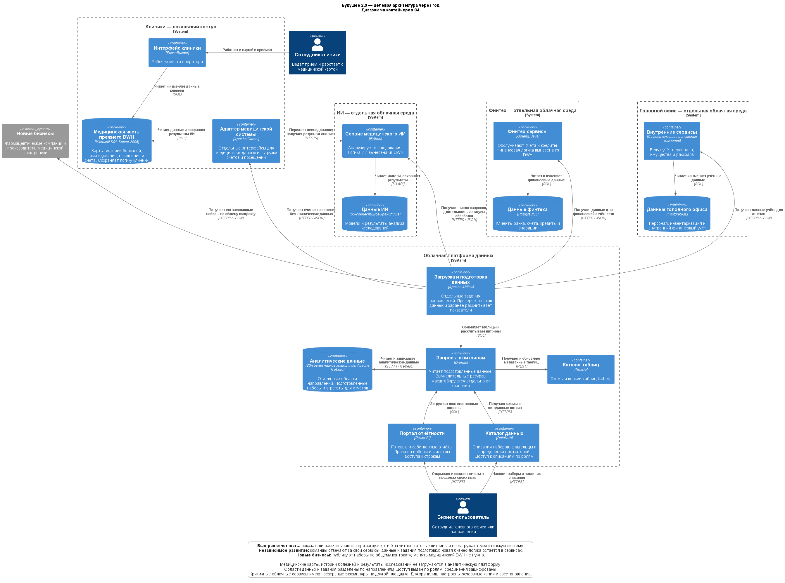

# Задание 1. Целевая архитектура и приоритеты

Целевое состояние через год: сотрудники сами строят отчёты в пределах своих прав, направления развивают сервисы независимо, новые бизнесы подключают свои данные без расширения бизнес-логики общего хранилища.

## Целевая архитектура

Основа решения — Data Mesh: команды направлений отвечают за свои сервисы, данные и правила их подготовки. Общая платформа предоставляет загрузку, хранение, выполнение запросов и каталог данных. Аналитическая часть построена как Data Lakehouse: данные хранятся в объектном хранилище в таблицах Iceberg, а обработка масштабируется отдельно.

1. **Клиники продолжают работать в PowerBuilder.** Медицинская часть прежнего корпоративного хранилища данных (DWH) на SQL Server 2008 сохраняет карты, истории болезней, исследования и логику работы клиники. Apache Camel остаётся адаптером этой системы. Через один интерфейс он передаёт исследования сервису ИИ и сохраняет результат, через другой — выдаёт счета и данные посещений для отчётности. Второй интерфейс отдаёт только согласованный список полей: без карт, диагнозов, историй болезней и результатов исследований.

2. **Финтех, ИИ и головной офис работают в отдельных облачных средах.** Финансовая и ИИ-логика перенесена из DWH в соответствующие сервисы. Финтех хранит свои операции в PostgreSQL, ИИ — модели и результаты анализа в собственном объектном хранилище. Внутренние сервисы головного офиса используют отдельную базу для персонала, имущества и расходов. Разработка нового финансового или ИИ-сервиса не требует изменения медицинского DWH.

3. **Команды публикуют данные для аналитики через свои интерфейсы.** Для каждого набора определены владелец, состав полей, формат, частота обновления и разрешённые потребители. Apache Airflow запускает отдельные задания направлений, проверяет состав данных и через Dremio обновляет таблицы и рассчитывает витрины. Данные лежат в отдельных областях объектного хранилища; Nessie хранит метаданные таблиц Iceberg. ИИ-направление передаёт только показатели работы сервиса: число запросов, длительность и статусы обработки. Медицинские карты, истории болезней и результаты исследований в аналитическую платформу не загружаются.

4. **Сотрудник строит отчёты в Power BI.** Портал использует подготовленные витрины через Dremio. Показатели рассчитываются при обновлении данных, поэтому построение отчёта не запускает повторную обработку всего DWH. Доступ к наборам и строкам проверяется по ролям, в том числе для собственных отчётов пользователя. Служебная учётная запись загрузки Power BI имеет доступ только к предназначенным для отчётности витринам. DataHub помогает найти набор, прочитать его описание и узнать владельца; сам отчёты не строит. Команды согласуют определения общих показателей, чтобы отчёты разных направлений можно было сопоставлять.

5. **Новый бизнес подключает собственные наборы по тем же правилам.** Для него создаются область хранения, задания загрузки, описание в каталоге и права доступа. Бизнес-правила остаются в его сервисах. Общий медицинский DWH при подключении не меняется.

Критичные облачные сервисы имеют резервные экземпляры на другой площадке. Для хранилищ предусмотрены резервное копирование и проверка восстановления. Между локальным контуром клиник и облаком используется защищённое соединение; доступ к медицинским исследованиям есть только у клиники и обслуживающего её ИИ-сервиса. Для медицинских и финансовых данных выбираются площадки с учётом требований к их размещению. Контроль прав действует в сервисах и хранилищах, а не только в интерфейсе портала.

PowerBuilder, медицинская часть SQL Server и адаптер Apache Camel остаются на первый год: полная замена клинической системы не нужна для запуска портала и отделения финтеха и ИИ. Power BI сохраняется, но получает данные из новых витрин. Остальная бизнес-логика и соответствующие данные перенесены в сервисы направлений. Это убирает зависимость новых продуктов от общего DWH и сохраняет привычную работу клиник.

## Проблемы и приоритеты

Приоритеты заданы методом MoSCoW для горизонта одного года:

- **Must have** — без решения не достигаются цели первого года.
- **Should have** — снижает стоимость сопровождения и упрощает развитие после запуска.
- **Could have** — полезное улучшение при наличии свободных ресурсов.
- **Won't have this time** — не входит в первый год.

| № | Проблема текущей системы | Какой сценарий страдает | Последствие для бизнеса | Приоритет и причина | Решение в целевой архитектуре |
| --- | --- | --- | --- | --- | --- |
| 1 | Сложные отчёты строятся часами; большие объёмы данных проходят множество преобразований. | Получение управленческой и финансовой отчётности. | Руководство поздно получает сведения о выручке, расходах и работе направлений. | **Must have.** Быстрая отчётность — основная цель портала первого года. | Заранее рассчитывать показатели в отдельных аналитических витринах. Выполнять запросы через Dremio и масштабировать обработку отдельно от хранения. |
| 2 | В DWH сосредоточена бизнес-логика клиник, финтеха и ИИ. | Выпуск новых финансовых и ИИ-сервисов. | Изменение одного направления требует работы с общей системой и замедляет вывод услуг на рынок. | **Must have.** Независимое развитие направлений нужно для запуска новых продуктов и роста выручки. | Перенести логику финтеха и ИИ в их сервисы, выделить им собственные хранилища и облачные среды. |
| 3 | Операционные медицинские и финансовые данные хранятся вместе с данными для аналитики. | Самостоятельная работа сотрудников с отчётами при ограничении доступа. | Нельзя открывать пользователям общий массив данных: в нём находятся карты, истории болезней и исследования, исключённые из витрины. | **Must have.** Портал должен выдавать только разрешённые данные и учитывать права сотрудника. | Выгружать явно заданные аналитические наборы, исключить клиническое содержимое до загрузки, разделить области хранения и настроить права на наборы и строки. |
| 4 | Power BI содержит много кастомизаций поверх общего DWH. | Построение собственных отчётов и сравнение показателей направлений. | Развитие отчётности связано с изменениями общего хранилища и существующих доработок. | **Must have.** Пользователь должен создавать отчёты сам, а компания — видеть общие бизнес-показатели. | Подключить Power BI к подготовленным витринам, предоставить конструктор отчётов и описать наборы и общие показатели в DataHub. |
| 5 | Интеграции направлений проходят через общую старую шину и связаны с DWH. | Подключение фармацевтических компаний и производителя электроники. | Подключение нового бизнеса затрагивает общий слой интеграций и хранилище. Это увеличивает объём согласованных изменений и срок запуска. | **Should have.** Единые контракты сокращают срок подключения партнёров. Первую версию портала можно запустить на данных существующих направлений. | Публиковать наборы через интерфейсы направлений по общему контракту. Camel оставить только адаптером медицинской системы. |
| 6 | Существующая инфраструктура должна обслуживать сотни терабайт данных и растущее число сценариев. | Рост отчётности и подключение новых направлений. | Нагрузка на общую систему растёт вместе с бизнесом; увеличиваются затраты на поддержку старого оборудования. | **Must have.** Без масштабирования рост компании сохранит проблему медленных отчётов. | Перенести платформу данных и выделенные сервисы в облако, разделить ресурсы хранения и обработки, предусмотреть резервирование и резервные копии. |
| 7 | PowerBuilder и медицинский DWH сохраняют зависимость клиник от старой системы. | Сопровождение и дальнейшее развитие медицинского направления. | Изменения медицинских процессов по-прежнему требуют доработки старого приложения и хранилища. | **Should have** — изолировать старую систему и снять с неё общую аналитику. Полная замена — **Won't have this time**: она не нужна для достижения целей первого года. | Сохранить рабочее место клиники и медицинскую логику, ограничить связи адаптером, вывести финтех, ИИ и общую отчётность из DWH. |
