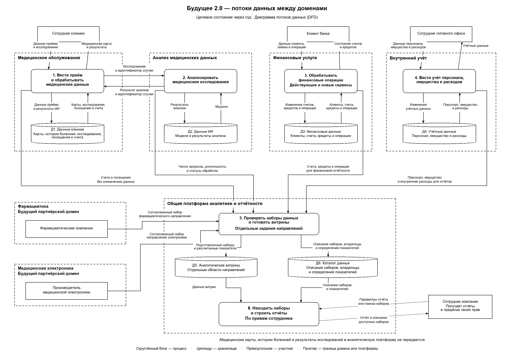

# Задание 2. Домены и потоки данных

## Домены

| Домен | Ответственность и собственные данные | Что передаёт другим | Почему выделен отдельно |
| --- | --- | --- | --- |
| Медицинское обслуживание | Приём пациентов, медицинские карты, истории болезней, исследования, посещения и счета клиник. | ИИ-сервису — исследование и идентификатор случая. В аналитику — счета и посещения без клинического содержимого. | Правила медицинского обслуживания и доступ к картам определяет команда клиник. Изменения банковских продуктов не затрагивают медицинскую систему. |
| Финансовые услуги | Клиенты банка, счета, кредиты и финансовые операции. Включает действующие и новые финтех-сервисы. | Наборы для финансовой отчётности. | Финансовые продукты имеют собственные правила обработки операций. Их можно выпускать без изменения медицинского хранилища. |
| Анализ медицинских данных | Анализ исследований, модели ИИ и результаты обработки. | Клинике — результат анализа с идентификатором случая. В аналитику — число запросов, длительность и статусы обработки. | Команда ИИ меняет модели и способы анализа независимо от банковских и учётных сервисов. |
| Внутренний учёт | Персонал, имущество и расходы головного офиса. | Учётные данные для общей отчётности. | Внутреннее управление компанией имеет свои правила и не должно зависеть от изменений медицинской или банковской логики. |
| Фармацевтика | Данные фармацевтического бизнеса и правила их подготовки. Владельцы — команды будущих партнёров. | Согласованные наборы фармацевтического направления. | Партнёр сохраняет свои системы и правила работы с данными. Для подключения достаточно опубликовать наборы по общему контракту. |
| Медицинская электроника | Данные производителя медицинской электроники и правила их подготовки. Владелец — команда производителя. | Согласованные наборы направления электроники. | Производитель развивает свои системы независимо от клиник, банка и фармацевтических компаний. |

Фармацевтика и медицинская электроника показаны как будущие партнёрские домены. Их внутренние системы на схеме не раскрываются. Общая платформа аналитики обслуживает все направления; она не забирает у них владение исходными данными.

## Диаграмма потоков данных

На диаграмме DFD (Data Flow Diagram) стрелки направлены от источника данных к получателю. Процессы обозначены номерами 1–6, хранилища — Д1–Д6. Отдельные стрелки показывают чтение и запись, а также отправку исследования и возврат результата.

Процессы 1–4 объединяют работу сервисов соответствующего домена. В медицинском домене сохраняются PowerBuilder, медицинская часть прежнего корпоративного хранилища данных (DWH) и адаптер Apache Camel. Д1 — это медицинское хранилище; Д2–Д4 принадлежат своим направлениям. Между доменами нет прямого доступа к чужим хранилищам.

Процесс 5 соответствует загрузке и подготовке данных через Airflow и Dremio из задания 1. Д5 содержит аналитические витрины в отдельных областях направлений. Д6 — каталог DataHub. Процесс 6 объединяет поиск описаний в каталоге и построение отчётов в Power BI по данным витрин. ИИ означает искусственный интеллект.

## Как обеспечены бизнес-сценарии

1. **Использование ИИ в клинике.** Процесс 1 получает исследование из Д1 и передаёт его процессу 2 вместе с идентификатором случая. ИИ использует модель из Д2, сохраняет результат и возвращает его клинике. Клиника связывает результат с нужным случаем, сохраняет его в Д1 и показывает сотруднику. Исследования и результаты анализа остаются в медицинском и ИИ-доменах.

2. **Подключение нового финтех-сервиса.** Сервис добавляется в финансовом домене, представленном процессом 3. Он использует данные этого домена и сохраняет результаты финансовых операций в Д3. Для отчётности команда публикует набор через интерфейс финансового домена. Процесс 5 загружает его в отдельную аналитическую область и обновляет описание в каталоге. Медицинский DWH в этом пути не участвует.

3. **Подключение фармацевтики и производителя электроники.** Команда партнёра определяет состав набора, владельца, описание полей, определения показателей, частоту обновления и разрешённых потребителей. Для набора создаются задание загрузки, область хранения и запись в каталоге. Обработка внутри партнёрского домена остаётся у партнёра; новая бизнес-логика в медицинский DWH не добавляется.

4. **Общая отчётность.** Процесс 5 получает разрешённые наборы направлений, проверяет их состав и рассчитывает показатели. С каждым набором передаются описание, владелец и определения показателей; они попадают в Д6. Подготовленные данные сохраняются в Д5. По запросу сотрудника процесс 6 предоставляет описания доступных наборов и строит отчёт с учётом прав на наборы и строки. Общие определения показателей позволяют сопоставлять данные разных направлений.

Медицинский интерфейс выгрузки отдаёт только согласованные поля счетов и посещений. Карты, истории болезней, диагнозы и результаты исследований не входят в эти наборы. ИИ передаёт в аналитику показатели работы сервиса без содержимого исследований и результатов анализа. Проверка состава выполняется до записи в Д5.

Такое разделение сокращает число совместных изменений: клиники отвечают за медицинские процессы, банк — за финансовые продукты, команда ИИ — за анализ исследований, а партнёры — за собственные данные. Общая отчётность использует опубликованные наборы и не требует переносить правила этих направлений в DWH.