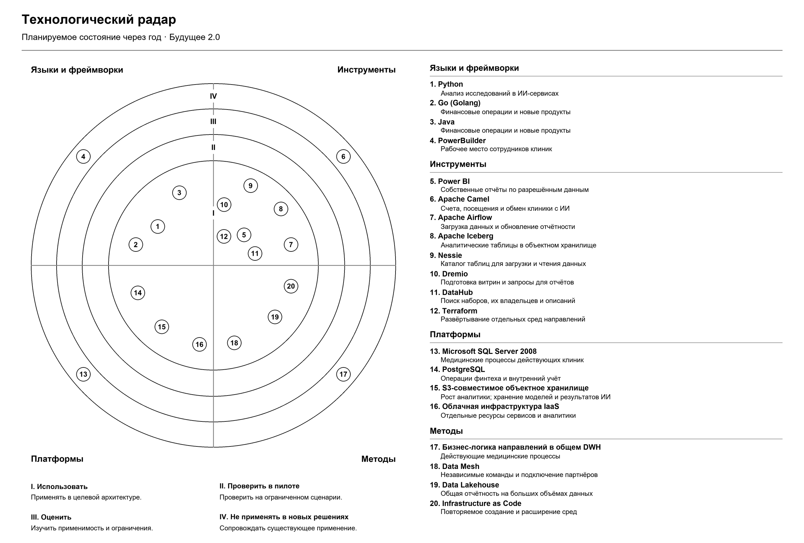

# Задание 3. Технологический радар и дорожная карта

## Технологический радар

Радар показывает **планируемое состояние на конец 12-го месяца**. Текущее использование и предстоящие изменения указаны в таблицах. Номера на схеме совпадают с номерами строк.

| Кольцо | Значение |
| --- | --- |
| I. Использовать | Применять в целевой архитектуре. Новые решения проходят пилотирование до ввода в эксплуатацию. |
| II. Проверить в пилоте | Проверить решение на ограниченном бизнес-сценарии перед внедрением. |
| III. Оценить | Изучить применимость и ограничения решения. |
| IV. Не применять в новых решениях | Сопровождать существующее применение; новые сервисы и интеграции строить на выбранных заменах. |

Кольца II и III свободны: для выбранных решений пилоты предусмотрены в дорожной карте, а к концу года запланировано их рабочее использование. Положение в кольце I обозначает цель проекта. В колонке «Сейчас» отражён ландшафт из условия; «Новое» означает предлагаемое внедрение.

### Языки и фреймворки

| № | Технология | Сейчас | Через год: статус и изменение | Бизнес-сценарий |
| --- | --- | --- | --- | --- |
| 1 | Python | ИИ-сервисы. | **Использовать.** Сохранить язык сервисов; перенести в них ИИ-логику из общего хранилища. | Менять анализ исследований независимо от банковских и медицинских приложений. |
| 2 | Go (Golang) | Финтех-сервисы. | **Использовать.** Развивать финансовые сервисы в отдельной среде со своей базой. | Выпускать финансовые продукты без изменения медицинского хранилища. |
| 3 | Java | Финтех-сервисы. | **Использовать.** Сохранить существующие сервисы; перенести в финансовый домен его логику из общего хранилища. | Развивать банковские операции и продукты силами команды финтеха. |
| 4 | PowerBuilder | Рабочее место сотрудников клиник. | **Не применять в новых решениях.** Сохранить медицинский интерфейс на первый год. | Продолжать приём пациентов во время переноса аналитики и логики других направлений. |

### Инструменты

| № | Технология | Сейчас | Через год: статус и изменение | Бизнес-сценарий |
| --- | --- | --- | --- | --- |
| 5 | Power BI | Отчёты с доработками поверх общего хранилища. | **Использовать.** Переключить отчёты на подготовленные витрины через Dremio; открыть создание собственных отчётов с правами на наборы и строки. | Самостоятельно получать отчёт по нужным срезам в пределах своего доступа. |
| 6 | Apache Camel | Общая интеграционная шина. | **Не применять в новых решениях.** Оставить адаптером медицинской системы: обмен с ИИ и отдельная выгрузка счетов и посещений. | Сохранить обмен клиник с ИИ и передавать разрешённые данные для отчётности. |
| 7 | Apache Airflow | Новое. | **Использовать.** Запускать отдельные задания загрузки и подготовки данных направлений. | Обновлять отчётность по расписанию, не связывая все направления одной обработкой. |
| 8 | Apache Iceberg | Новое. | **Использовать.** Хранить аналитические данные и витрины в табличном формате в объектном хранилище. | Готовить общую отчётность на растущем объёме данных. |
| 9 | Nessie | Новое. | **Использовать.** Вести каталог метаданных таблиц Iceberg. | Обращаться к нужным таблицам при обновлении витрин и построении отчётов. |
| 10 | Dremio | Новое. | **Использовать.** Выполнять обработку по заданиям Airflow и обслуживать запросы Power BI к витринам. | Строить отчёты по заранее рассчитанным показателям без повторной обработки всего медицинского хранилища. |
| 11 | DataHub | Новое. | **Использовать.** Описывать наборы, владельцев, поля и общие определения показателей. | Находить данные для отчёта и одинаково понимать показатели разных направлений. |
| 12 | Terraform | Новое. | **Использовать.** Описать и развёртывать облачные виртуальные машины, диски и сети. | Создавать отдельные среды направлений и расширять ресурсы по мере роста. |

### Платформы

| № | Технология | Сейчас | Через год: статус и изменение | Бизнес-сценарий |
| --- | --- | --- | --- | --- |
| 13 | Microsoft SQL Server 2008 | Общее корпоративное хранилище данных (DWH) с медицинскими, финансовыми и учётными данными и бизнес-логикой. | **Не применять в новых решениях.** Сохранить медицинскую часть; перенести общую аналитику, данные других направлений и их логику. | Сохранить работу клиник и убрать зависимость новых финансовых и ИИ-сервисов от медицинского хранилища. |
| 14 | PostgreSQL | Новое. | **Использовать.** Выделить отдельные базы финансовому домену и внутреннему учёту. | Хранить финансовые операции, персонал, имущество и расходы в системах ответственных направлений. |
| 15 | S3-совместимое объектное хранилище | Новое. | **Использовать.** Выделить области для аналитических данных и собственное хранилище ИИ для моделей и результатов. | Наращивать объём аналитики; хранить модели и результаты анализа в ИИ-домене. |
| 16 | Облачная инфраструктура IaaS | Планируется перенос основной части ландшафта в облако. | **Использовать.** Создать отдельные среды финтеха, ИИ, внутреннего учёта и общей платформы; резервировать критичные сервисы на другой площадке. | Масштабировать направления независимо и поддерживать доступность сервисов. |

IaaS (Infrastructure as a Service) — аренда вычислительных ресурсов, дисков и сетей в облаке. S3 — интерфейс доступа к объектному хранилищу; конкретный поставщик в этом задании не выбирается.

### Методы

| № | Подход | Сейчас | Через год: статус и изменение | Бизнес-сценарий |
| --- | --- | --- | --- | --- |
| 17 | Бизнес-логика направлений в общем DWH | Значительная часть правил и обработки сосредоточена в общем хранилище. | **Не применять в новых решениях.** Оставить медицинскую логику в старой системе; правила остальных направлений перенести в их сервисы. | Сохранить медицинские процессы и выпускать новые продукты без доработки общего хранилища. |
| 18 | Data Mesh | Новое. | **Использовать.** Передать командам доменов ответственность за данные, правила подготовки и публикацию; платформе — общие средства работы с данными. | Развивать подразделения отдельно и подключать партнёров через опубликованные наборы. |
| 19 | Data Lakehouse | Новое. | **Использовать.** Объединить объектное хранение, таблицы Iceberg и обработку Dremio в общей аналитической платформе. | Масштабировать хранение и обработку отдельно, готовить отчёты по данным разных направлений. |
| 20 | Infrastructure as Code | Новое. | **Использовать.** Хранить описание инфраструктуры в конфигурации Terraform и применять согласованные изменения. | Повторять создание сред и расширять ресурсы без ручной сборки каждой среды с нуля. |

ИИ — искусственный интеллект. Медицинские карты, истории болезней и результаты исследований остаются в медицинском и ИИ-доменах согласно потокам задания 2. Эти данные не попадают в аналитическую платформу и портал.

## Дорожная карта на 12 месяцев

### 1. Месяцы 1–2: согласовать архитектуру и проекты доменов

**Бизнес-цель:** определить, как запустить портал и развивать направления независимо; выполнить промежуточную цель через два месяца.

**Работы:**

- Согласовать архитектуру из задания 1, границы и потоки шести доменов из задания 2. Назначить владельцев данных существующих направлений и ответственных за подключение будущих партнёров.
- Запланировать проекты: клиники — адаптер и выгрузка счетов и посещений; финтех — перенос логики и финансовых данных; ИИ — перенос логики и публикация показателей работы сервиса; головной офис — собственная база внутреннего учёта; партнёры — публикация согласованных наборов; общая платформа — витрины и портал.
- Определить состав наборов, частоту обновления, права, владельцев и общие показатели. Исключить клиническое содержимое из аналитических выгрузок.
- Замерить время существующих отчётов и нагрузку на хранилище, зафиксировать расходы на текущую инфраструктуру. Согласовать с бизнесом требования к свежести данных, времени отчёта, допустимому перерыву и восстановлению медицинских и финансовых сервисов.

**Результат:** согласованы архитектура, владельцы, контракты данных, проекты направлений и критерии приёмки. Команды знают состав своих работ и зависимости.

**Ответственные:** архитектор и владельцы направлений; команды клиник, финтеха, ИИ, внутреннего учёта и платформы; специалисты по информационной безопасности.

**Ресурсы:** рабочее время архитектора, аналитиков, владельцев данных и ведущих разработчиков; описания действующих систем и отчётов; доступ к статистике нагрузки и тестовой среде для проверки выгрузок.

### 2. Месяцы 3–4: подготовить облако и первый аналитический набор

**Бизнес-цель:** получить основу для независимых сервисов и проверить путь от данных направления до отчёта.

**Работы:**

- Подготовить через Terraform отдельные облачные среды направлений и платформы: сети, виртуальные машины и диски. Настроить защищённую связь с клиниками и права сервисов на свои хранилища.
- Развернуть объектное хранилище, Iceberg, Nessie, Dremio, Airflow и DataHub; подготовить базы PostgreSQL финтеха и внутреннего учёта, хранилище ИИ. Настроить резервные копии и резервные экземпляры критичных облачных сервисов на другой площадке; проверить восстановление.
- Провести пилот на счетах и посещениях клиник: адаптер выдаёт только согласованные поля, Airflow проверяет состав, Dremio готовит витрину, DataHub содержит описание, Power BI показывает отчёт.
- Сверить количество записей и суммы с источником. Проверить доступ к наборам и строкам под разными ролями, исключение клинических полей и нагрузку выгрузки на медицинскую систему.

**Результат:** подготовлены отдельные среды; первый отчёт строится по новой витрине. Проверены загрузка, доступ и восстановление. Пилот даёт замеры для настройки платформы перед подключением остальных доменов.

**Ответственные:** команда платформы и инфраструктурные инженеры; команда клиник отвечает за выгрузку; аналитики отчётности и специалисты по безопасности проверяют данные и права.

**Ресурсы:** инженеры инфраструктуры и данных, администраторы баз, разработчик медицинского адаптера и аналитик Power BI; тестовая и рабочая облачные среды; виртуальные машины, диски, объектное хранилище, резервная площадка и защищённый канал; доступ Power BI к витрине. Объём пилотных ресурсов выбирается по первому набору и замерам нагрузки.

### 3. Месяцы 5–8: выделить сервисы доменов и провести пилот портала

**Бизнес-цель:** дать финтеху и ИИ возможность выпускать изменения независимо; предоставить сотрудникам первые собственные отчёты.

**Работы:**

- Перенести финансовую и ИИ-логику из DWH в существующие сервисы на Go, Java и Python. Перенести финансовые данные в PostgreSQL, модели и результаты ИИ — в хранилище этого домена. Выделить данные персонала, имущества и расходов в базу внутреннего учёта.
- Подключить наборы финтеха, ИИ и головного офиса к платформе. ИИ публикует только число запросов, длительность и статусы обработки. Для каждого набора создать отдельное задание, область хранения и описание в DataHub.
- Подготовить общие витрины, переключить выбранные отчёты Power BI и провести пилот портала с сотрудниками направлений. Проверить построение собственных отчётов и ограничения доступа, включая учётную запись подключения: ей доступны только витрины.
- Переносить операции и отчёты по очереди. Перед переключением сверять финансовые остатки, операции и отчётные суммы; для ИИ проверять передачу исследования, связь результата со случаем и возврат в клинику. На каждом переключении определить единственный источник записи и порядок отката с учётом новых операций.

**Результат:** сервисы и данные существующих направлений размещены в своих средах; сотрудники пилотных групп строят отчёты по общим витринам. Новый финансовый сервис использует данные своего домена и публикует набор для аналитики без изменения медицинского DWH. Клиники продолжают работать в PowerBuilder.

**Ответственные:** команды финтеха, ИИ и внутреннего учёта выполняют перенос своих сервисов и данных; команда клиник проверяет медицинский обмен; команда платформы и аналитики Power BI ведут пилот; владельцы данных принимают результаты сверок.

**Ресурсы:** разработчики Go, Java и Python, разработчики внутренних сервисов, инженеры данных, администраторы баз, тестировщики и представители бизнес-пользователей; тестовые и рабочие среды доменов; временные мощности и место для копий на период сверки и переключения; действующие модели ИИ и контрольные сценарии обмена с клиникой; доступ сотрудников к пилоту Power BI.

### 4. Месяцы 9–12: запустить портал и подключить партнёров

**Бизнес-цель:** открыть самостоятельную отчётность всем предусмотренным ролям, подключать новые направления и выдерживать рост нагрузки.

**Работы:**

- Подключить к порталу оставшиеся согласованные отчёты и группы пользователей. Проверить права на наборы и строки, подготовить инструкции по поиску данных и созданию отчётов, передать сопровождение командам.
- Подключить согласованные наборы фармацевтических компаний и производителя электроники: владельцы, контракты, задания загрузки, отдельные области хранения и записи в каталоге. Сохранить бизнес-логику в системах партнёров.
- Проверить время отчётов, свежесть витрин и параллельную работу пользователей при росте объёма данных. По результатам расширить вычислительные ресурсы и хранение; сравнить время отчётов и расходы на инфраструктуру с исходными значениями.
- Проверить восстановление и переключение критичных облачных сервисов на резервную площадку. Удалить из рабочего расписания старые аналитические задания только после приёмки соответствующих новых отчётов. Освободить ресурсы перенесённых задач, сохранив медицинский SQL Server 2008, PowerBuilder и адаптер Camel.

**Результат:** портал работает для согласованных ролей; существующие направления и партнёры публикуют свои данные. Команды принимают отчёты по критериям первого этапа. Подтверждены работа под расчётной нагрузкой и восстановление критичных сервисов; медицинская система продолжает обслуживать клиники.

**Ответственные:** команда платформы и аналитики Power BI — запуск портала; команды партнёров — свои наборы; команды доменов — сверка и приёмка отчётности; инфраструктурные инженеры — нагрузка, резервирование и расходы; специалисты по безопасности — права доступа.

**Ресурсы:** инженеры данных и инфраструктуры, аналитики отчётности, тестировщики, владельцы наборов и представители партнёров; рабочая платформа, резервная площадка и среда нагрузочной проверки; мощности и хранение для объёма подключённых данных; доступ пользователей к Power BI и время на обучение. Размеры ресурсов уточняются по измеренной нагрузке.
