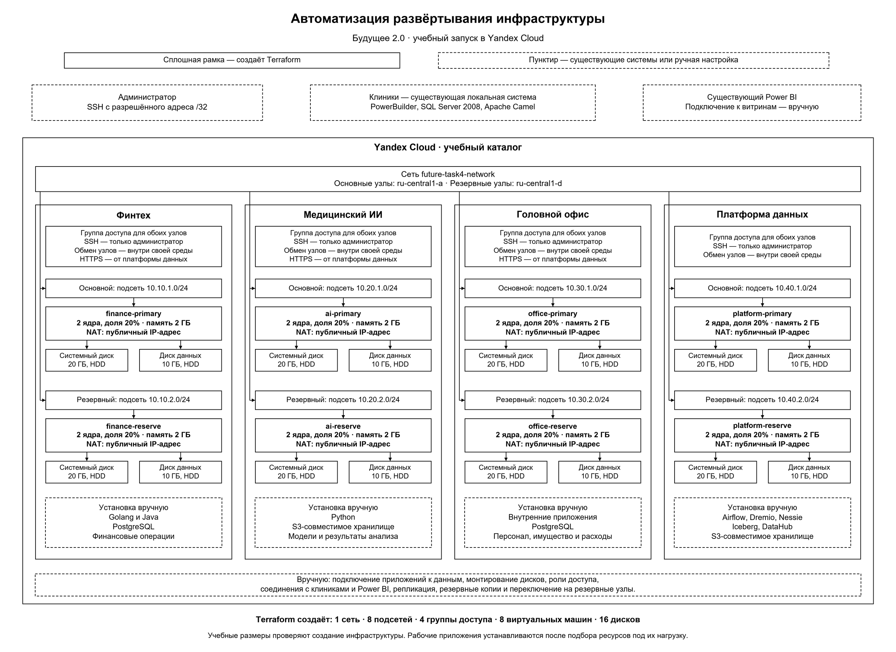
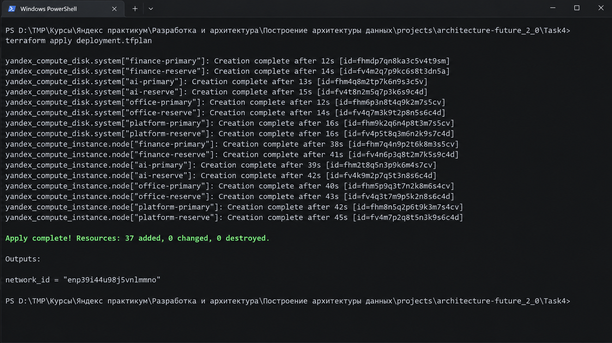

# Задание 4. Облачная инфраструктура и Terraform



## Что создаёт Terraform

| Компонент | Количество | Назначение |
| --- | --- | --- |
| Облачная сеть | 1 | Объединяет подсети проекта. |
| Подсети | 8 | По одной для каждого узла; адреса разных сред не пересекаются. |
| Группы доступа | 4 | Разделяют сетевой доступ к финтеху, ИИ, головному офису и платформе. |
| Виртуальные машины | 8 | По основной и резервной машине на среду. |
| Системные диски | 8 | Операционная система Ubuntu 24.04 LTS. |
| Диски данных | 8 | Отдельное от операционной системы место для данных приложений. |

Всего описано **37 ресурсов Terraform**. Восемь публичных адресов выделяются в составе сетевых интерфейсов машин при `nat = true`.

Terraform связывает сеть с подсетями, диски и группы доступа — с соответствующими машинами. Эти ссылки определяют порядок создания ресурсов. Имена содержат общий префикс `future-task4`, название среды и роль узла: `primary` — основной, `reserve` — резервный.

Основные машины находятся в `ru-central1-a`, резервные — в `ru-central1-d`. Каждому узлу создаются собственные диски в его зоне. Резервные машины дают место для второго экземпляра сервиса. Репликация данных, переключение и проверка восстановления настраиваются после установки приложений.

## Размеры ресурсов

| Параметр одного узла | Учебное значение | Почему выбран |
| --- | --- | --- |
| Процессор | 2 виртуальных ядра, гарантированная доля 20% | Для создания машины, работы операционной системы и проверки подключения по SSH. |
| Память | 2 ГБ | Для проверки инфраструктуры без запуска прикладного стека. |
| Системный диск | 20 ГБ, `network-hdd` | Для Ubuntu и служебных файлов. |
| Диск данных | 10 ГБ, `network-hdd` | Для проверки отдельного диска и его подключения. |

SSH — защищённое подключение к серверу. HDD — диск на магнитном накопителе. Для учебной проверки важны создание ресурсов и их связи; высокая производительность дисков здесь не нужна.

## Сеть и NAT

NAT (Network Address Translation) — преобразование сетевых адресов. Как в примере урока, для сетевого интерфейса включён `nat = true`: машина получает публичный адрес для подключения администратора и выхода в интернет. Отдельная машина или шлюз для NAT не создаётся.

Входящий SSH разрешён только с адреса администратора, заданного с маской `/32`. Основной и резервный узлы могут обмениваться данными внутри своей среды. Для финтеха, ИИ и головного офиса разрешён HTTPS на порту 443 из подсетей платформы: через него платформа получает опубликованные наборы. HTTPS — передача данных по зашифрованному соединению.

Прямой доступ платформы к базам других направлений не открыт. Публикация приложений для клиник и Power BI, сертификаты и прикладные права относятся к ручной настройке. При этом адреса и порты необходимых входящих подключений добавляются в правила Terraform после определения точек подключения. Учебный запуск проверяет инфраструктуру до этого этапа.

## Что выполняется вручную

- Финтех: установка существующих сервисов на Go и Java, PostgreSQL и перенос финансовых данных.
- ИИ: установка Python-сервисов, настройка S3-совместимого хранилища, загрузка моделей. S3 — интерфейс объектного хранилища; ИИ — искусственный интеллект.
- Головной офис: установка внутренних приложений и PostgreSQL, перенос данных учёта.
- Платформа: установка Airflow, Dremio, Nessie, DataHub и объектного хранилища, настройка таблиц Iceberg и заданий подготовки данных.
- Общие работы: разметка и монтирование дисков данных, подключение Power BI и клиник, настройка ролей, репликации, резервного копирования и переключения на резервные узлы.

PowerBuilder, медицинская часть SQL Server 2008 и адаптер Camel продолжают работать в локальном контуре. Медицинские карты, истории болезней и результаты исследований в аналитическую платформу не передаются.

## Зачем нужен декларативный подход

Конфигурация описывает нужные ресурсы и связи между ними. Terraform определяет порядок создания по зависимостям: сначала сеть, затем подсети, диски и машины. Перед применением команда `plan` показывает будущие изменения.

Infrastructure as Code — управление инфраструктурой через код — позволяет повторить это развёртывание в другом учебном каталоге, заменив входные параметры. Для увеличения ресурсов среды меняются её параметры, затем проверяется новый план. Фиксация версии провайдера и файл `.terraform.lock.hcl` сохраняют выбор зависимостей между запусками.

## Запуск и проверка

Используются Terraform версии от 1.9 до 2.0 и провайдер `yandex-cloud/yandex` версии `0.225.0`.

1. В [terraform.tfvars](terraform.tfvars) заполнить `cloud_id`, `folder_id`, `administrator_cidr` и `administrator_public_key`. Последнее поле содержит только открытый ключ SSH.
2. Передать действующий токен Yandex Cloud через переменную окружения `YC_TOKEN`.
3. Из каталога `Task4` выполнить:

```powershell
terraform fmt -check
terraform init
terraform validate
terraform plan "-out=deployment.tfplan"
```

4. Проверить состав ресурсов и стоимость. Для пустого учебного каталога ожидаются 37 создаваемых ресурсов. Затем применить сохранённый план:

```powershell
terraform apply deployment.tfplan
terraform output
```

5. Проверить, что машины запущены скриншот успешного `apply.png`: 
